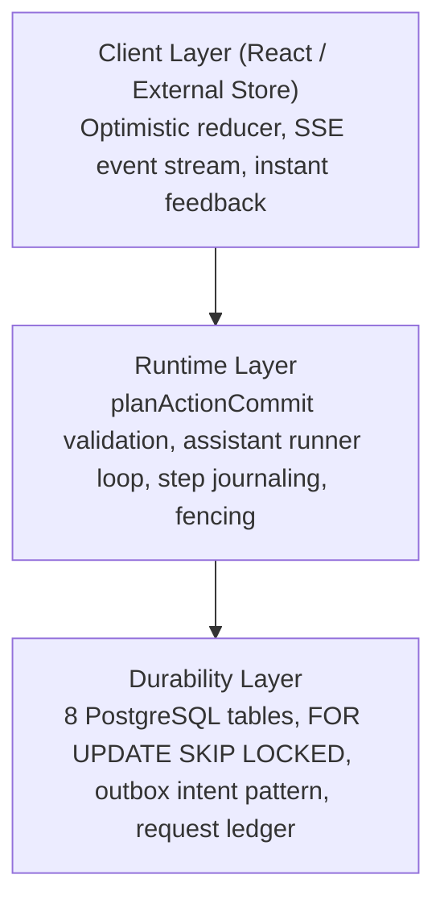

# interaction-builder

[](https://www.npmjs.com/package/interaction-builder)
[](LICENSE)
[](https://www.typescriptlang.org/)

**Deterministic conversational interaction engine with transactional persistence, tool execution, and UI synchronization.**

Interaction Builder allows you to build AI-powered collaborative workspaces (cohort planners, canvas editors, kanban boards, document suites) where **users and AI assistants collaborate on the exact same live state** with transactional durability, optimistic UI updates, and zero state desynchronization.

---

## Why Interaction Builder?

LLMs are probabilistic, whereas business applications require strict consistency:
1. **Compounding Failures**: 5 sequential tool calls with a 90% success rate lead to a 59% chance of failure without durable step journaling and replay recovery.
2. **Race Conditions**: When a user edits an item in the browser while an AI assistant is deliberating on an older snapshot, naive systems overwrite the user's change. Interaction Builder enforces monotonic revisions (`STALE_WORKSPACE`) without polling.
3. **Ghost Workers**: Background AI workers that timeout or crash must never commit stale mutations. Interaction Builder uses token-fenced database leases (`FOR UPDATE SKIP LOCKED`).
4. **Idempotency Guarantee**: Retrying a crashed assistant run reuses committed receipts via deterministic UUID hashing without repeating side-effects.

---

## Architecture Overview



---

## Documentation

Explore the complete documentation in [`docs/`](./docs/README.md):

- 📖 **[Quickstart Guide](./docs/quickstart.md)**: Zero-to-running in 5 minutes
- 🏛️ **[Architecture & Durability Engine](./docs/architecture.md)**: 3-Layer model, revisions, outbox, and lease fencing
- 📜 **[Core Contracts & Schemas](./docs/core-contracts.md)**: Envelopes, receipts, entity refs, and reducer
- ⚙️ **[Runtime Orchestration](./docs/runtime-guide.md)**: Action service, handlers, runner loop, and crash recovery
- ⚛️ **[React & Client Store](./docs/react-and-client.md)**: `<InteractionProvider>`, typed hooks, optimistic updates
- 🔌 **[Adapters Guide](./docs/adapters-guide.md)**: PostgreSQL (`pg.Pool`), AI SDK, and Web standard HTTP
- 🧪 **[Testing Guide](./docs/testing-guide.md)**: Unit, integration, and headless component testing with `testkit`
- 🛠️ **[Custom Domain Walkthrough](./docs/custom-domain-example.md)**: Full tutorial building a Meeting Agenda domain

---

## Subpath Exports & Profiles

The package provides strict subpath isolation so consumers only bundle and install what their runtime environment requires:

| Export | Environment | Required Dependencies | Description |
|---|---|---|---|
| `interaction-builder` | Node.js (Isomorphic) | `zod` | Combined barrel exporting `core`, `runtime`, and `client`. |
| `interaction-builder/core` | Universal (Browser & Server) | `zod` | Schemas, action envelopes, receipts, entity refs, events, and pure reducer. Zero server dependencies. |
| `interaction-builder/client` | Browser | `zod` | Reactive external store, HTTP transport, cross-tab broadcast, and SSE stream parser. Zero React/database dependencies. |
| `interaction-builder/react` | React (Browser) | `react >= 18`, `react-dom >= 18`, `zod` | `<InteractionProvider>`, `useWorkspaceView`, `useSendMessage`, `useDispatchAction`, `useInteractionHistory`. Client component boundary (`'use client'`). |
| `interaction-builder/runtime` | Server (Node.js) | `zod` | Generic repository interface, action planning service, handlers, runner loop, deterministic UUIDs. |
| `interaction-builder/adapters/pg` | Server (Node.js) | `pg ^8.11.0` (optional peer) | Pure PostgreSQL repository using native `pg.Pool` without ORM dependencies. |
| `interaction-builder/adapters/sqlite` | Server / Edge / Local | None (uses injected driver) | Universal SQLite / LibSQL repository for local dev, desktop, Turso, Cloudflare D1. |
| `interaction-builder/adapters/http` | Server (Web Standard) | None | Web Fetch standard `Request` / `Response` dispatcher for Next.js, Express, Fastify, or Cloudflare Workers. |
| `interaction-builder/adapters/ai` | Server | `ai ^7.0.0` | Vercel AI SDK adapter (`createAiSdkModelAdapter`) with error boundaries and abort signaling. |
| `interaction-builder/testkit` | Tests | `ai ^7.0.0` | `MemoryInteractionRepository`, scripted mock models, and reference domain fixtures (`agendaDomain`). |

> **Browser Bundling Rule**: For frontend web apps, always import from `interaction-builder/core`, `interaction-builder/client`, or `interaction-builder/react`. Do not import from server-facing subpaths (`/runtime`, `/adapters/pg`) to avoid bundling server modules.

---

## Quick Start Snippet

### 1. Define a Domain (`core`)

```ts
import { z } from 'zod';
import type { DomainDefinition } from 'interaction-builder/core';

export const documentSchema = z.object({ title: z.string() });
export type DocumentState = z.infer<typeof documentSchema>;

export const documentDomain: DomainDefinition<DocumentState> = {
  id: 'document',
  version: 1,
  initialState: (b) => documentSchema.parse(b),
  plan: (state, actionInput, ctx) => {
    if (ctx.expectedRevision !== ctx.currentRevision) throw new Error('STALE_WORKSPACE');
    return {
      nextState: { ...state, title: (actionInput as any).title },
      changed: [],
      invalidated: [],
      summary: 'Updated title',
      undoable: true,
    };
  },
};
```

### 2. Mount React UI (`react`)

```tsx
'use client';

import React from 'react';
import { InteractionProvider, useWorkspaceView, useSendMessage, useDispatchAction } from 'interaction-builder/react';

export function DocumentApp({ workspaceId, initialDoc }: { workspaceId: string; initialDoc: DocumentState }) {
  return (
    <InteractionProvider workspaceId={workspaceId} initialView={initialDoc}>
      <DocumentView />
    </InteractionProvider>
  );
}

function DocumentView() {
  const doc = useWorkspaceView<DocumentState>();
  const dispatchAction = useDispatchAction();
  const sendMessage = useSendMessage();

  return (
    <div>
      <h1>{doc.title}</h1>
      <button onClick={() => dispatchAction({ type: 'set_title', title: 'New Title' })}>
        Rename Direct
      </button>
      <button onClick={() => sendMessage('Make this title more punchy')}>
        Ask Assistant
      </button>
    </div>
  );
}
```

---

## Reference Examples

A complete standalone Agenda domain is included under [`examples/agenda/`](./examples/agenda/):

```bash
npx tsx examples/agenda/run.ts
```

This verifies the end-to-end lifecycle:
1. Workspace creation & chat message ingestion
2. Assistant turn deliberation & multi-step tool execution
3. Monotonic revision advancement & receipts
4. Direct client UI mutations with conflict detection
5. Server-rendered and interactive React components

---

## License

MIT © [th-efool](https://github.com/th-efool)
