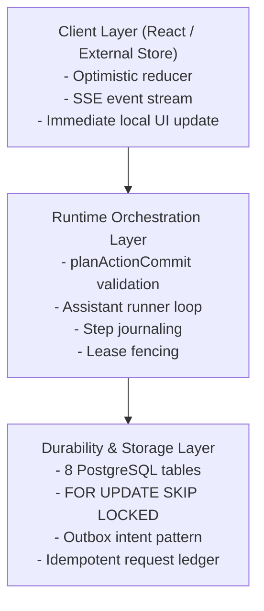

# Architecture & Durability Engine

Interaction Builder bridges the fundamental mismatch between **probabilistic LLM execution** and **deterministic business logic**.

When an AI model generates tool calls across multiple steps, network requests can drop, background processes can crash, multiple tabs can edit the same workspace, and concurrent worker processes can conflict. Interaction Builder eliminates compounding errors through transactional persistence and fencing.

---

## The 3-Layer Architecture



### Layer 1: Client & Optimistic UI (`interaction-builder/client` & `react`)
- Pure external store driven by `interactionReducer`.
- Actions apply optimistically to local state while the HTTP request is in-flight.
- On server confirmation, the receipt reconciles the optimistic state with the server revision.
- If rejected (`STALE_WORKSPACE`), the store rewinds the action and marks it as failed.

### Layer 2: Runtime Orchestration (`interaction-builder/runtime`)
- Pure domain planning: the domain's `plan()` function receives current state, action input, and revision context, producing `{ nextState, changed, summary }`.
- Run ownership and fencing: only one worker can process a run at a time via lease tokens.
- Assistant loop (`runAssistantTurn`): steps are journaled as `started` &rarr; `completed` or `failed`.
- Idempotency verification: retried steps reuse the cached commit receipt instead of re-mutating state.

### Layer 3: Durable Storage (`interaction-builder/adapters/pg`)
- PostgreSQL transaction boundary.
- Atomically persists state snapshots, sequence counters, event streams, and outbox intents.
- Zero ORM dependencies — built directly with native `pg.Pool`.

---

## Durability Invariants

### 1. Monotonic Workspace Revisions
Every state modification advances `revision` by exactly 1:
```text
State(rev=0) --[action 1]--> State(rev=1) --[action 2]--> State(rev=2)
```
Every mutation envelope includes `expectedRevision`. If `expectedRevision !== currentRevision`, the commit rejects with `STALE_WORKSPACE`. This guarantees:
- Concurrent edits in multiple browser tabs never silently overwrite each other.
- LLM turns deliberating on an old snapshot cannot corrupt newer edits made by the user in the UI.

### 2. Single Active Run Enforcement
The PostgreSQL schema defines a partial unique index:
```sql
CREATE UNIQUE INDEX idx_interaction_runs_active 
ON interaction_runs(workspace_id) 
WHERE status IN ('queued', 'running');
```
This guarantees at the database level that no workspace can ever have two simultaneous assistant runs scheduled or executing in parallel.

### 3. Worker Leases and Fencing
Background workers claim queued runs using row locks:
```sql
SELECT * FROM interaction_runs 
WHERE status = 'queued' OR (status = 'running' AND lease_until < NOW())
ORDER BY created_at ASC 
LIMIT 1 
FOR UPDATE SKIP LOCKED;
```
Each worker receives a random `leaseToken` and a finite lease expiry. When a worker commits an action or records a step, it passes `runFence: { runId, leaseToken }`.
If the worker's lease expired, or if another worker took over, the transaction rejects with `FENCE_EXPIRED`, preventing zombie workers from modifying state.

### 4. Step Journaling and Crash Recovery
During an assistant turn, tool invocations are journaled into `interaction_steps`:
- `started`: Recorded before executing the domain action.
- `completed`: Recorded after the domain action succeeds, caching the commit receipt and revision.
- `failed`: Recorded if an unrecoverable failure occurred.

If the worker machine crashes immediately after committing an action to the database:
1. The lease expires.
2. A replacement worker claims the run with a new `leaseToken`.
3. The runner replays the steps. At the crashed step, it detects the existing completed request in `interaction_requests`.
4. It returns the previously committed receipt **without re-running the mutation** or creating duplicate entities.
5. The assistant turn proceeds to the next step cleanly.

### 5. Idempotent Request Ledger & Deterministic UUIDs
Every step generates a deterministic `requestId` (`step:${runId}:${ordinal}`).
In host domain tools (e.g., agenda tools):
```ts
const actionId = meta?.requestId ? deterministicUuid('action:' + meta.requestId) : crypto.randomUUID();
```
Because the action envelope is hashed and stored in `interaction_requests`, replayed requests match bit-for-bit, preventing false `IDEMPOTENCY_MISMATCH` errors while strictly rejecting malicious or conflicting payload reuse.
