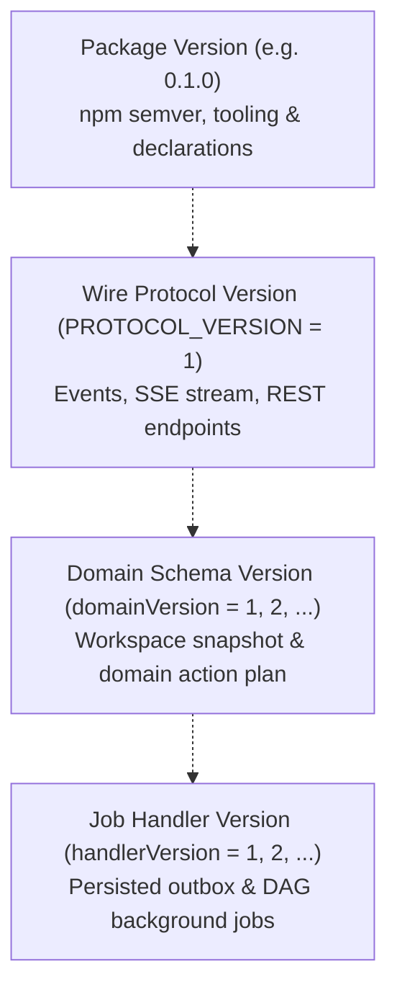
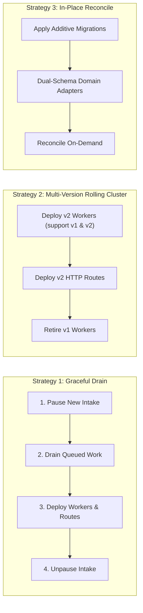

# Versioning, Installation, and Upgrade Contracts

This document specifies the authoritative versioning contracts, installation requirements, database migration ownership, and upgrade procedures for `interaction-builder`.

---

## 1. Architectural Versioning Model

Interaction Builder enforces strict separation between software packaging, wire/event protocols, host domain schemas, and background job handlers.



### 1.1 Package Version vs. Protocol Version

- **Package Version (`PACKAGE_VERSION`)**:
  - Semantic versioning (`MAJOR.MINOR.PATCH`) for library distribution.
  - Minor and patch updates (e.g. `0.1.0` -> `0.1.1` -> `0.2.0`) contain bug fixes, performance optimizations, and additive adapters without altering wire contracts.
- **Protocol Version (`PROTOCOL_VERSION = 1`)**:
  - Defines the binary/JSON wire protocol for interaction events (`interaction_events.protocolVersion`), SSE streaming format, and REST action envelopes.
  - Hardcoded and enforced in `interactionEventSchema`:
    ```typescript
    export const PROTOCOL_VERSION = 1;
    export const interactionEventSchema = z.strictObject({
      protocolVersion: z.literal(1),
      eventId: z.string().uuid(),
      workspaceId: z.string().uuid(),
      sequence: z.number().int().positive(),
      type: z.enum([...]),
      ...
    });
    ```
  - Independent of package version. Bumping the package version does **not** bump the protocol version unless the event stream or client-server transport schema undergoes a breaking change.
  - Events with unknown or unsupported protocol versions fail validation (`isSupportedProtocolVersion(v) === false`).

### 1.2 Host Domain Schema Versions (`domainVersion`)

- Every interaction workspace is bound to a specific domain and version:
  - Stored in `interaction_workspaces.domainVersion` (e.g. `1`, `2`).
  - Domain definitions declare their current version and optional multi-version compatibility predicate:
    ```typescript
    export interface DomainDefinition<State = any> {
      id: string;
      version: number;
      /** Optional predicate for multi-version backward compatibility during rolling deployments */
      supportsVersion?: (version: number) => boolean;
      initialState(bootstrap: unknown): State;
      plan(...): DomainActionPlan<State>;
    }
    ```
- **Unsupported-Version Rejection**:
  - If a workspace has `domainVersion: 2`, but an HTTP route or worker node only runs `DomainDefinition` with `version: 1` (and `supportsVersion(2) === false`), the request is rejected:
    - HTTP Action Commit: returns HTTP 400 with `{ code: 'UNSUPPORTED_DOMAIN_VERSION', retryable: false }`.
    - Assistant Runner: throws `UNSUPPORTED_DOMAIN_VERSION` before model invocation, preventing state corruption.

### 1.3 Persisted Job & Handler Versions (`handlerVersion`)

- Background asynchronous tasks (e.g., `interaction_outbox` payloads or DAG jobs like `host_background_jobs`) persist a `handlerVersion` integer (e.g. `1`, `2`).
- Workers executing queued jobs explicitly check compatibility:
  ```sql
  WHERE j."handlerVersion" IN (1, 2) AND j."status" = 'queued'
  ```
- Workers encountering unknown handler versions leave the job untouched or fail with `S3_HANDLER_VERSION_UNSUPPORTED`, preventing premature retry exhaustion or corruption.

---

## 2. Division of Responsibilities Matrix

To preserve clean boundaries, responsibilities are partitioned strictly between the reusable package and the host application:

| Subsystem / Concern | Reusable Package (`interaction-builder`) | Host Application (e.g., `host-app`) |
|---|---|---|
| **Identity & Authentication** | Accepts verified `ownerId: string` and `actorId: string`. Zero auth tokens, sessions, or cookies in engine. | Resolves session cookies, JWTs, OAuth tokens, and enforces origin / CSRF verification. |
| **Authorization & Tenant Isolation** | Enforces `ownerId` filtering across workspaces, runs, messages, proposals, and receipts. | Defines workspace membership, organization roles, permissions, and sharing policies. |
| **Storage & Persistence** | Provides SQL schemas (`001_interaction_schema.sql`), row-level locks, CAS check (`expectedRevision`), and step journals. | Provisions PostgreSQL/SQLite databases, runs database migrations, sets connection pools, and manages backups. |
| **Domain State & Actions** | Provides action planning pipeline (`planActionCommit`), optimistic client reducer, and history snapshotting. | Defines business entities, domain schemas (Zod), action reducers, validation invariants, and pin rules. |
| **AI Model & Provider** | Provides runner loop (`runAssistantTurn`), step journaling, tool routing, abort signals, and token usage accounting. | Instantiates AI SDK provider (`openai`, `anthropic`, `google`), supplies API keys, and sets model parameters. |
| **Worker Supervision** | Provides lease fencing (`FOR UPDATE SKIP LOCKED`), lease renewals, and failure state transitions. | Runs background worker processes, monitors OS signals (`SIGTERM`), and configures concurrency quotas. |
| **Source Ingestion & Grounding** | Generic entity reference contracts (`entityRefSchema`). Zero domain connectors in engine. | Scrapes web pages, downloads PDFs, calls GitHub/YouTube APIs, chunks text, and computes citations. |
| **UI Presentation** | Headless client store, `<InteractionProvider>`, and hooks (`useWorkspaceView`, `useSendMessage`). | Visual theme, CSS variables, typography, layouts, badges, forms, and dialogs. |

---

## 3. Database Migration Ownership & Additive Contracts

### 3.1 Migration Boundaries

1. **Engine Schema Ownership**:
   - The package owns tables prefixed with `interaction_*`:
     - `interaction_workspaces`
     - `interaction_requests`
     - `interaction_events`
     - `interaction_outbox`
     - `interaction_messages`
     - `interaction_runs`
     - `interaction_steps`
     - `interaction_proposals`
   - Migrations reside in `migrations/` (e.g. `001_interaction_schema.sql`).
2. **Host Schema Ownership**:
   - The host application owns its domain tables (e.g., `host_agenda_meetings`, `host_agenda_items`, `host_agenda_receipts`, `host_background_jobs`).

### 3.2 Additive Migration Rules

- **Strictly Additive**:
  - `CREATE TABLE IF NOT EXISTS`
  - `ALTER TABLE ... ADD COLUMN IF NOT EXISTS`
  - New columns must be either `NULLABLE` or define a safe `DEFAULT`.
  - **Never** drop tables, rename columns in-place, or drop constraints during active operation.
- **Transactional DDL**:
  - All migrations must wrap in `BEGIN; ... COMMIT;`.
  - If any statement in an upgrade script fails (e.g. syntax error or disk full), the entire transaction rolls back (`ROLLBACK`). The previous baseline remains completely uncorrupted.

---

## 4. Rolling Upgrades & Queued Work Strategies

When deploying updates across a distributed cluster with active user sessions and background workers, choose between three strategies:



### 4.1 Strategy 1: Graceful Drain
- Recommended for scheduled maintenance windows.
- Set server policy to pause new intake (e.g. `INTERACTION_V2_INTAKE_ENABLED=0`).
- Wait for active runs and outbox deliveries to reach 0 (`queue depth = 0`).
- Deploy new worker binaries and apply migrations.
- Re-enable intake.

### 4.2 Strategy 2: Multi-Version Rolling Cluster
- Recommended for zero-downtime production deployments.
- Worker processes advertise supported versions during run claims:
  ```typescript
  const run = await repo.claimRun({
    leaseOwner: workerId,
    leaseToken,
    leaseDurationMs: 30000,
    supportedDomainVersions: [1, 2], // Accepts both v1 and v2
  });
  ```
- In PostgreSQL and SQLite, `claimRun` joins `interaction_workspaces` and filters:
  ```sql
  WHERE (r."status" = 'queued' OR ...) AND w."domainVersion" = ANY($supportedVersions)
  ```
- Old workers only claim runs they can process; new workers process both v1 and v2 runs.
- Once all v1 instances are decommissioned, update domain definitions to retire v1 support.

### 4.3 Strategy 3: In-Place State Reconciliation
- If domain state shapes evolve between versions (e.g., adding structured sections to items):
  - In Native Profile: The domain's `plan` function or state loader inspects `snapshot.schemaVersion`. If older, it dynamically transforms the snapshot to the target version on first write.
  - In Host-Owned Profile: Host database migration scripts update host business tables independently. Interaction workspace binding continues to point to `meetingId` without data migration.

---

## 5. Safe Downgrade Limitations

1. **Additive Schema Compatibility**:
   - Because all database migrations are additive (`NULLABLE` or default columns), a previous software version can connect to an upgraded database schema without syntax failures.
2. **State Downgrade Boundary**:
   - Workspaces created or modified by a higher domain version (e.g. `domainVersion: 2`) **cannot** be safely mutated by an older engine instance running a v1-only domain definition.
   - The older instance will reject mutations with `UNSUPPORTED_DOMAIN_VERSION` (HTTP 400).
   - This fail-closed behavior guarantees that new features or state fields are never silently stripped or corrupted.
3. **Emergency Rollback Procedure**:
   - Revert application binaries to the previous release.
   - Do **not** drop newly added columns or tables.
   - Existing v1 workspaces resume seamlessly.
   - Any workspaces created under the newer version remain safely paused until the forward fix is deployed.

---

## 6. Integration Profiles: Native vs. Host-Owned

Interaction Builder provides two distinct profiles for managing application data:

### Profile 1: Native Interaction-Managed State
- **Use Case**: Collaborative workspaces built from scratch where Interaction Builder is the primary database authority (e.g., document drafts, whiteboards, meeting agendas).
- **Snapshot Contents**: Complete domain state is serialized into `interaction_workspaces.snapshot`.
- **Mutations**: Dispatched via `commitAction` and executed by pure `plan` functions. Revisions advance monotonically.
- **Rollback / Undo**: Native time-travel support via `useInteractionHistory`.

### Profile 2: Host-Owned Resource Integration
- **Use Case**: Existing enterprise applications with pre-existing database tables and relational schemas (e.g. meeting planners, CRM records, issue trackers).
- **Snapshot Contents**: Stores **only** resource pointers and selection metadata:
  ```typescript
  {
    schemaVersion: 1,
    resourceId: "resource-123",
    observedVersion: 4,
    selectedItemId: null
  }
  ```
  **Zero business data is duplicated in the interaction snapshot.**
- **Mutations**: Model tools and UI actions route through a unified, authorized host service (`HostService.executeCommand`).
- **Concurrency**: Host service enforces `expectedVersion` with row-level locks (`SELECT ... FOR UPDATE`). Stale model actions reject with HTTP 409 `CONFLICT` (`STALE_HOST_RESOURCE`).
- **Idempotency**: All host commands record receipts in a host receipts table (`(ownerId, commandId) UNIQUE`). Retried commands return the cached receipt without duplicating mutations.

---

## 7. Supported Runtime & Dependency Matrix

| Component | Minimum Supported Range | Recommended / Tested |
|---|---|---|
| **Node.js Runtime** | `>= 18.0.0` | Node `20.x`, `22.x`, `24.x` |
| **React** (Optional Peer) | `^18.0.0 \|\| ^19.0.0` | React `19.0.0` |
| **PostgreSQL Driver** (`pg`) | `^8.11.0` | `pg 8.11.5` / PostgreSQL `14+` |
| **SQLite Driver** (`better-sqlite3`) | `^9.0.0 \|\| ^11.0.0` | `better-sqlite3 11.8.1` |
| **AI SDK** (`ai`) | `^3.0.0 \|\| ^4.0.0 \|\| ^7.0.0` | Vercel AI SDK `ai 7.0.0` |
| **Schema Validation** (`zod`) | `^3.24.0` | `zod 3.24.2` |

---

## 8. Clean-Host Installation Checklist

To integrate `interaction-builder` into a clean host application:

### Step 1: Install Package & Peer Dependencies
```bash
# Minimal core and runtime
npm install interaction-builder zod

# If using PostgreSQL adapter
npm install pg
npm install -D @types/pg

# If using React frontend UI
npm install react react-dom
npm install -D @types/react @types/react-dom

# If using Vercel AI SDK
npm install ai @ai-sdk/openai
```

### Step 2: Initialize Database
Run the additive engine migration against your PostgreSQL database:
```bash
psql $DATABASE_URL -f node_modules/interaction-builder/migrations/001_interaction_schema.sql
```
*(Or read the migration file in your Node startup script and execute it via `pg.Pool.query()`)*.

### Step 3: Define Your Domain Definition
```typescript
import { z } from 'zod';
import type { DomainDefinition } from 'interaction-builder/runtime';

export const myStateSchema = z.object({ title: z.string() });
export type MyState = z.infer<typeof myStateSchema>;

export const myDomain: DomainDefinition<MyState> = {
  id: 'my-workspace',
  version: 1,
  initialState: (bootstrap) => myStateSchema.parse(bootstrap),
  plan: (state, actionInput, ctx) => {
    if (ctx.expectedRevision !== ctx.currentRevision) throw new Error('STALE_WORKSPACE');
    const action = actionInput as { type: string; title: string };
    return {
      nextState: { ...state, title: action.title },
      changed: [],
      invalidated: [],
      summary: `Updated title to ${action.title}`,
      undoable: true,
    };
  },
};
```

### Step 4: Wire Web Standard HTTP Dispatcher
In your server route (e.g. Next.js App Router, Express, or Hono):
```typescript
import { dispatchInteraction } from 'interaction-builder/adapters/http';
import { createPgInteractionRepository } from 'interaction-builder/adapters/pg';
import { Pool } from 'pg';
import { myDomain } from './domain';

const pool = new Pool({ connectionString: process.env.DATABASE_URL });
const repo = createPgInteractionRepository({ pool });
const domains = new Map([[myDomain.id, myDomain]]);

export async function POST(req: Request) {
  // 1. Authenticate user session
  const ownerId = await resolveUserSession(req);
  if (!ownerId) return new Response('Unauthorized', { status: 401 });

  // 2. Dispatch to interaction handler
  const url = new URL(req.url);
  const path = url.pathname.replace(/^\/api\/interaction\/v1\/?/, '');
  return dispatchInteraction({
    path,
    method: req.method,
    headers: req.headers,
    body: await req.json().catch(() => null),
    ownerId,
    repo,
    domains,
  });
}
```

### Step 5: Mount Client React Provider
```tsx
'use client';
import { InteractionProvider, useWorkspaceView, useSendMessage, useDispatchAction } from 'interaction-builder/react';

export function WorkspaceApp({ workspaceId }: { workspaceId: string }) {
  return (
    <InteractionProvider workspaceId={workspaceId} basePath="/api/interaction/v1">
      <WorkspaceView />
    </InteractionProvider>
  );
}

function WorkspaceView() {
  const { snapshot, revision, isConnected } = useWorkspaceView<MyState>();
  const { sendMessage } = useSendMessage();
  const { dispatchAction } = useDispatchAction();

  return (
    <div>
      <h1>{snapshot?.title} (Rev: {revision})</h1>
      <button onClick={() => dispatchAction({ type: 'set_title', title: 'New Title' })}>
        Rename
      </button>
    </div>
  );
}
```

### Step 6: Supervise Background AI Worker
```typescript
import { createPgInteractionRepository } from 'interaction-builder/adapters/pg';
import { runAssistantTurn } from 'interaction-builder/runtime';
import { Pool } from 'pg';
import { myDomain } from './domain';
import { myModelAdapter } from './model';

const pool = new Pool({ connectionString: process.env.DATABASE_URL });
const repo = createPgInteractionRepository({ pool });

async function workerLoop() {
  while (true) {
    const claimed = await repo.claimRun({
      leaseOwner: 'worker-1',
      leaseToken: crypto.randomUUID(),
      leaseDurationMs: 30000,
      supportedDomainIds: [myDomain.id],
      supportedDomainVersions: [myDomain.version],
    });

    if (!claimed) {
      await new Promise(r => setTimeout(r, 1000));
      continue;
    }

    try {
      await runAssistantTurn({
        workspaceId: claimed.workspaceId,
        ownerId: 'system', // or resolve from workspace
        repo,
        domain: myDomain,
        model: myModelAdapter,
        createTools: (deps) => ({ /* your tools */ }),
        runId: claimed.id,
      });
      await repo.completeRun({ runId: claimed.id, leaseToken: claimed.leaseToken! });
    } catch (err: any) {
      await repo.failRun({ runId: claimed.id, leaseToken: claimed.leaseToken!, error: err.message });
    }
  }
}
```
